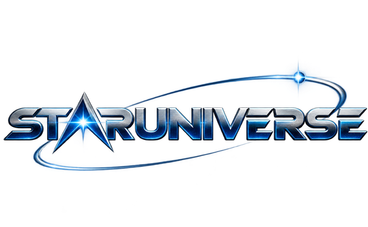

# StarUniverse — Alpha

**ES** · Estrategia en tiempo real de ciencia ficción: tres razas, batallas contra la IA y un ladder online con ligas y
temporadas. Hecho con Kova Engine.

**EN** · Science-fiction real-time strategy: three races, battles against the AI and an online ladder with leagues and
seasons. Made with Kova Engine.

> **Alpha de pruebas / Alpha test.** El juego está en desarrollo: habrá fallos, cambios de equilibrio y
> actualizaciones frecuentes, y el progreso del ladder puede reiniciarse. / The game is in development: expect bugs,
> balance changes and frequent updates; ladder progress may be reset.

## Descargar / Download

Descarga el instalador de tu sistema en **[Releases](../../releases)** / Get the installer for your system from
**[Releases](../../releases)**:

| Sistema / System | Archivo / File |
| --- | --- |
| Windows 10/11 (64-bit) | `staruniverse-<version>-Setup.exe` |
| Ubuntu / Debian | `staruniverse_<version>_amd64.deb` |
| Fedora | `staruniverse-<version>.x86_64.rpm` |

- **Windows:** el instalador no está firmado todavía; si Windows avisa, pulsa "Más información" → "Ejecutar de todos
  modos". / The installer is not signed yet: if Windows warns you, choose "More info" → "Run anyway".
- **Linux:** necesita Vulkan (drivers actuales de NVIDIA, AMD o Intel). / Requires Vulkan (current NVIDIA, AMD or
  Intel drivers).
- **Online:** crea tu cuenta dentro del juego y verifica tu email. / Create your account in the game and verify your
  e-mail.

## Reportar fallos / Report bugs

Web del juego, ranking y formulario de reportes / Game website, ranking and bug report form:
**https://staruniverse.kloop.co**

---

This repository hosts the alpha installers only. Hecho con / Made with Kova Engine. Animated unit portraits made with
MiniMax H3 (MiniMax H3 Community License). Terrain textures from Poly Haven (CC0).
